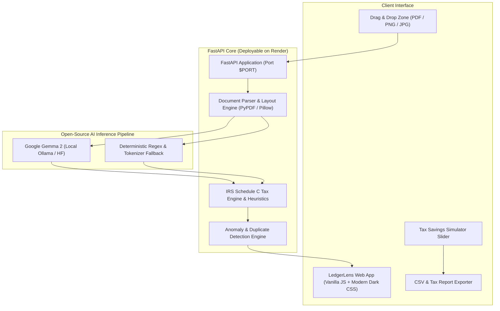

# 🔍 LedgerLens

> **Privacy-First AI Invoice & Expense Auditor for Freelancers and Solopreneurs.**  
> Built with open-source AI and open-weight models at its core. Zero client data leaks. 100% offline-ready or deployable directly to **Render**.

[](LICENSE)
[](https://render.com)
[](https://huggingface.co/google/gemma-2-9b-it)
[](#-irs-schedule-c-tax-engine)

---

## 💡 The Problem: The Freelancer's Invoice Dilemma

Freelancers, developers, and agency owners juggle dozens of receipts and client invoices each month. Traditional accounting tools (QuickBooks, Expensify) present major friction:

1. **Confidentiality & NDA Violations**: Closed-source cloud accounting platforms upload itemized client invoices (showing client names, secret rates, project code names, and bank details) to third-party proprietary AI platforms.
2. **Expensive SaaS Lock-In**: Charging $35–$70/month for simple document sorting and basic exports.
3. **Flawed Tax Classification**: Generic OCR tools fail to apply specific IRS Schedule C rules (e.g., the 50% business meal deduction rule under IRC § 274(n), Form 1099-NEC contractor filings, and the $75 receipt archiving requirement).

---

## ⚡ The Solution: LedgerLens

**LedgerLens** is a dedicated side-hustle tool that turns messy PDFs, receipt photos, and vendor bills into verified, IRS-compliant expense ledgers.

- **Open-Weight Intelligence**: Runs open-weight vision & language models (**Google Gemma 2**, Llama 3 via Ollama or Hugging Face) alongside a deterministic offline parsing engine.
- **Strict Data Sovereignty**: Documents can be processed 100% locally on a laptop or inside an isolated private Docker container on **Render**. No client data is ever used to train commercial models.
- **Proactive Audit Defense**: Automatically verifies subtotal + tax math, warns of duplicate charges, checks $75 receipt archiving thresholds, and flags contractor payments exceeding $600 requiring Form 1099-NEC.

---

## 🏗️ System Architecture



---

## ✨ Key Features

| Feature | Description |
| :--- | :--- |
| **Open-Weight AI Pipeline** | Configurable inference supporting **Gemma 2**, Ollama, and high-precision offline NLP parsing. |
| **IRS Schedule C Automation** | Automatically categorizes expenses into Lines 8 (Advertising), 11 (Contract Labor), 18 (Office/Software), 24a (Travel), and 24b (Meals). |
| **50% Meal Rule Enforcement** | Applies the 50% deduction limit for business meals while retaining full expense ledger totals. |
| **Form 1099-NEC Alerts** | Flags any subcontractor payments totaling $600 or more with W-9 substantiation reminders. |
| **Mathematical Reconciliation** | Checks line items: flags discrepancies where extracted subtotal + tax does not equal total. |
| **Duplicate Expense Detection** | Prevents double-counting by matching vendor, transaction date, and amounts. |
| **Instant Export** | Download clean spreadsheet CSV or generated Markdown tax filing reports. |

---

## 🚀 Deploying to Render (Step-by-Step)

LedgerLens includes native Render deployment configuration with zero configuration required.

### Method 1: Render Blueprint (Recommended)
1. Push this repository to your GitHub account.
2. In the [Render Dashboard](https://dashboard.render.com), click **New +** > **Blueprint**.
3. Connect your repository. Render will automatically detect [`render.yaml`](render.yaml) and configure the Python web service.
4. Click **Apply**. Your app will be live on Render in minutes!

### Method 2: Render Docker Web Service
1. Click **New +** > **Web Service** in Render.
2. Select **Build and deploy from a Git repository**.
3. Choose the **Docker** runtime (Render will automatically detect [`Dockerfile`](Dockerfile)).
4. Set the name to `ledgerlens` and click **Create Web Service**.

---

## 💻 Local Development Quickstart

Run LedgerLens locally on your laptop with complete offline privacy:

```bash
# 1. Clone repository
git clone https://github.com/Akash10053218/LedgerLens.git
cd LedgerLens

# 2. Create virtual environment
python3 -m venv venv
source venv/bin/activate  # On Windows: venv\Scripts\activate

# 3. Install dependencies
pip install -r requirements.txt

# 4. Start local development server
uvicorn backend.app:app --host 127.0.0.1 --port 8000 --reload
```

Open your browser to: **`http://127.0.0.1:8000`**

### Running Unit Tests
```bash
python3 -m unittest backend.test_app
```

---

## 🔒 Why Open Innovation Matters for LedgerLens

1. **Client Confidentiality & Zero Data Leakage**: Invoices contain sensitive hourly billing rates, client customer lists, and financial records. Open-weight models ensure that inference stays on the user's hardware or private Render instance without feeding external LLMs.
2. **Predictable Unit Economics**: Closed vision APIs charge $0.02–$0.05 per document. At 1,000 documents per month, third-party API fees eat into freelancer margins. Open-weight inference on a fixed-cost server or laptop achieves zero marginal cost per page.
3. **No Vendor Lock-In**: LedgerLens can switch between local Ollama instances, Hugging Face open weights, or pure offline heuristic parsing with zero code rewrites.

---

## 📄 License

Distributed under the **MIT License**. See [`LICENSE`](LICENSE) for details.
