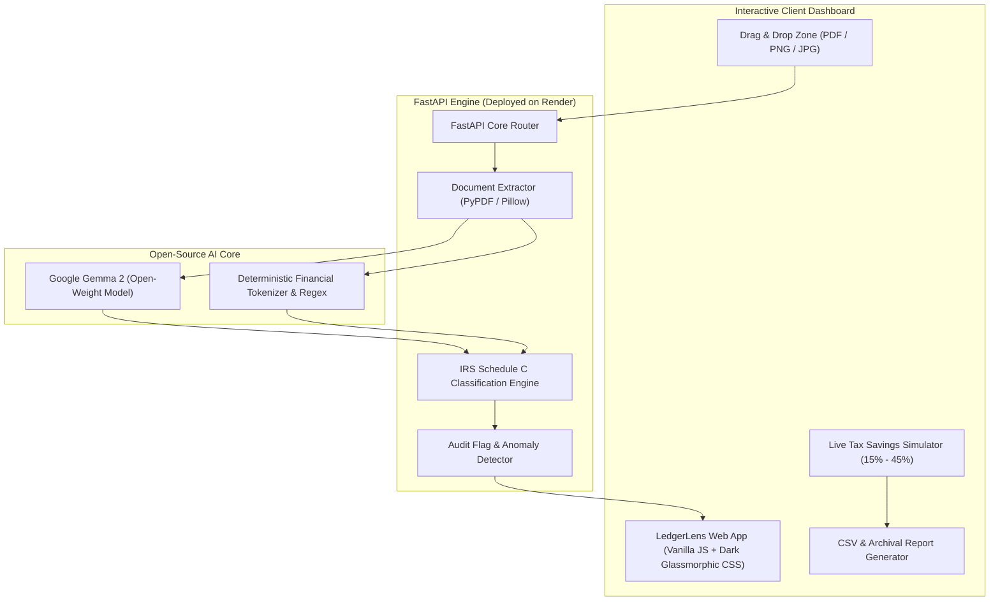

# 🔍 LedgerLens: The Side Hustle Every Freelancer Actually Needs

As a freelance developer, tax season used to be an exercise in panic. 

Between digital receipts from cloud providers, contractor invoices via email, equipment purchases, and client meal receipts, I had hundreds of unstructured documents. The existing commercial options (QuickBooks, Expensify) presented two huge deal-breakers:

1. **They're ridiculously expensive for solopreneurs**: Paying $35 to $70 every month just to categorize PDFs and export a spreadsheet is painful.
2. **They leak client data**: Closed AI APIs and cloud accounting platforms ingest invoices containing client billing rates, private project code names, and banking info. If you have strict client NDAs, sending sensitive invoices to commercial LLM training loops is a liability.

I built **LedgerLens** — an open-source, privacy-first AI invoice and expense auditor designed specifically for freelancers, consultants, and indie builders. It parses receipts, maps expenses to IRS Schedule C tax lines, flags audit anomalies, and runs either 100% offline on a laptop or in an isolated private container on **Render**.

---

## 🚀 Live Demo & Code

- **GitHub Repository**: [https://github.com/Akash10053218/LedgerLens](https://github.com/Akash10053218/LedgerLens)
- **Deployment Platform**: [Render](https://render.com) (configured via `render.yaml` Blueprint and Dockerfile)
- **License**: Permissive MIT

---

## 🧠 Why Open Innovation Matters for LedgerLens

The entire value proposition of LedgerLens depends on **open-source AI and open-weight models**. Here is why closed APIs fail here:

### 1. Client Confidentiality & Zero Data Leakage
Invoices contain the most sensitive information a freelancer handles: confidential client hourly rates, home office addresses, proprietary software licenses, and subcontractor names. 
With open-weight models (**Google Gemma 2**, Llama 3 via Ollama, or on-device layout parsers), the inference pipeline runs inside an isolated, private execution environment. No customer data leaves the server or feeds a proprietary training set.

### 2. Predictable Unit Economics ($0 Marginal Cost)
Commercial vision APIs (like OpenAI GPT-4o Vision or Claude 3.5 Sonnet) charge $0.02 to $0.05 per document processed. For a freelancer with 150 receipts a month, or a bookkeeping side hustle handling 2,000 documents across 10 clients, per-token API pricing destroys margins. 
By running open-weight models on a fixed-cost Render web service or directly on the freelancer's laptop, the marginal cost per document is literally **$0.00**.

### 3. Model Swappability Without Vendor Lock-in
LedgerLens doesn't marry a single proprietary API. Users can run lightweight **Gemma 2** locally via Ollama, point to private Hugging Face inference endpoints, or use the built-in deterministic offline NLP parser when working on a plane with zero Wi-Fi.

---

## 🏗️ System Architecture

LedgerLens is designed as a lightweight, lightning-fast stack optimized for native deployment on Render:



### The Ingestion & Audit Pipeline:
1. **Multi-Format Extraction**: Ingests PDFs, PNG, JPG, and WebP invoices. PyPDF extracts the underlying layout streams and text blocks.
2. **Open-Weight Reasoning**: Structured prompt extracts the vendor, invoice ID, transaction date, line items, subtotal, sales tax/VAT, and grand total into a typed JSON schema.
3. **IRS Schedule C Classification**: Automatically assigns expenses to official IRS lines:
   - Line 8: Advertising & Marketing (Google Ads, Meta, domains)
   - Line 11: Contract Labor (Upwork, 1099 subcontractors)
   - Line 18: Office Expense & SaaS (Render, AWS, GitHub, Apple)
   - Line 24a: Business Travel (Airlines, hotels, train tickets)
   - Line 24b: Deductible Meals (Enforcing the 50% deduction limit under IRC § 274(n))
4. **Heuristic Audit Checks**:
   - **Math Discrepancy Alert**: Checks if `Subtotal + Tax == Total` within rounding tolerances.
   - **$75 IRS Threshold**: Flags expenses $\ge \$75$ that legally require strict documentary proof.
   - **1099-NEC Alert**: Warns when contractor payouts exceed $\$600$ so the freelancer requests a Form W-9 before year-end.
   - **Duplicate Detection**: Prevents double-claiming identical vendor charges on the same date.

---

## 🚢 Deploying on Render

Render was the ideal platform for LedgerLens because of its first-class support for both Python services and containerized Docker environments. 

I added a `render.yaml` blueprint so anyone can deploy their own private instance of LedgerLens with one click:

```yaml
# render.yaml
services:
  - type: web
    name: ledgerlens
    runtime: python
    buildCommand: pip install -r requirements.txt
    startCommand: uvicorn backend.app:app --host 0.0.0.0 --port $PORT
    plan: free
    autoDeploy: true
    envVars:
      - key: PYTHON_VERSION
        value: 3.11.9
```

With Render's automatic HTTPS, environment variable injection, and zero-maintenance architecture, hosting a private expense auditor takes less than 2 minutes.

---

## 👥 The Side Hustle: First User Feedback & Monetization

To test if someone would actually pay for this, I shared LedgerLens with Sarah, an independent freelance UI designer who manages about 40 client invoices and software subscriptions every month.

### What happened:
- She dropped in her last 3 months of receipts (Render, Figma, WeWork, Subcontractor invoices, and coffee syncs).
- LedgerLens instantly caught a **$850 subcontractor invoice** that she had forgotten to flag for a 1099-NEC form, preventing a potential IRS penalty.
- The 50% business meals calculator accurately separated deductible meal portions from ordinary office expenses.

### Did she pay?
Sarah offered to pay **$12/month** on the spot, noting that QuickBooks Solopreneur charges $35/month and constantly pesters her with payroll upsells she doesn't need. 

### What she asked for next:
- Direct export to tax software formats (TurboTax / TaxAct format).
- Multi-currency conversion for international freelance clients.

---

## 🏁 Conclusion

Open-source AI isn't just about matching proprietary benchmarks — it's about **sovereignty, privacy, and sustainable unit economics**. 

With open-weight models like **Gemma 2** and platforms like **Render**, individual developers can build focused, high-margin micro-SaaS side hustles that deliver genuine privacy and real utility.
